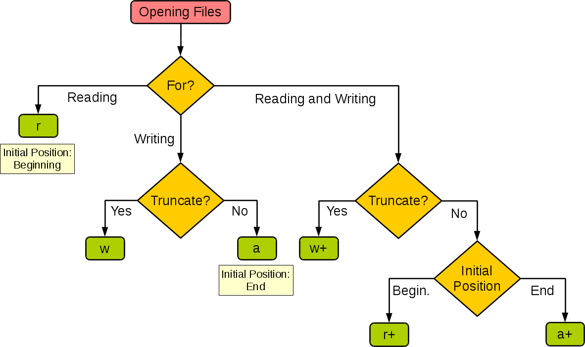

# 22.文件读写

## 文件读写

上一讲我们学习了异常处理机制，知道程序遇到意外时该怎么应对。这一讲我们学习**文件读写**，它是把数据长久保存下来、让程序"有记性"的基础。

实际开发中常常会遇到对数据进行持久化的场景，所谓持久化是指将数据从无法长久保存数据的存储介质（通常是内存）转移到可以长久保存数据的存储介质（通常是硬盘）中。实现数据持久化最直接简单的方式就是通过**文件系统**将数据保存到**文件**中。

计算机的**文件系统**是一种存储和组织计算机数据的方法，它使得对数据的访问和查找变得容易，文件系统使用**文件**和**树形目录**的抽象逻辑概念代替了硬盘、光盘、闪存等物理设备的数据块概念，用户使用文件系统来保存数据时，不必关心数据实际保存在硬盘的哪个数据块上，只需要记住这个文件的路径和文件名。在写入新数据之前，用户不必关心硬盘上哪个数据块没有被使用，硬盘上的存储空间管理（分配和释放）功能由文件系统自动完成，用户只需要记住数据被写入到了哪个文件中。

### 打开和关闭文件

有了文件系统，我们可以非常方便的通过文件来读写数据；在Python中要实现文件操作是非常简单的。我们可以使用Python内置的`open`函数来打开文件，在使用`open`函数时，我们可以通过函数的参数指定**文件名**、**操作模式**和**字符编码**等信息，接下来就可以对文件进行读写操作了。这里所说的操作模式是指要打开什么样的文件（字符文件或二进制文件）以及做什么样的操作（读、写或追加），具体如下表所示。

|操作模式|具体含义|
| --------| --------------------------------|
|`'r'`|读取 （默认）|
|`'w'`|写入（会先截断之前的内容）|
|`'x'`|写入，如果文件已经存在会产生异常|
|`'a'`|追加，将内容写入到已有文件的末尾|
|`'b'`|二进制模式|
|`'t'`|文本模式（默认）|
|`'+'`|更新（既可以读又可以写）|

下图展示了如何根据程序的需要来设置`open`函数的操作模式。



在使用`open`函数时，如果打开的文件是字符文件（文本文件），可以通过`encoding`参数来指定读写文件使用的字符编码。如果对字符编码和字符集这些概念不了解，可以看看[《字符集和字符编码》](https://www.cnblogs.com/skynet/archive/2011/05/03/2035105.html)一文，此处不再进行赘述。

使用`open`函数打开文件成功后会返回一个文件对象，通过这个对象，我们就可以实现对文件的读写操作；如果打开文件失败，`open`函数会引发异常，这一点我们在前面《异常处理》一讲中已经讲过如何处理。如果要关闭打开的文件，可以使用文件对象的`close`方法，这样可以在结束文件操作时释放掉这个文件。

### 读写文本文件

用`open`函数打开文本文件时，需要指定文件名并将文件的操作模式设置为`'r'`，如果不指定，默认值也是`'r'`；如果需要指定字符编码，可以传入`encoding`参数，如果不指定，默认值是None，那么在读取文件时使用的是操作系统默认的编码。需要提醒大家，如果不能保证保存文件时使用的编码方式与`encoding`参数指定的编码方式是一致的，那么就可能因无法解码字符而导致读取文件失败。

下面的例子演示了如何读取一个纯文本文件（一般指只有字符原生编码构成的文件，与富文本相比，纯文本不包含字符样式的控制元素，能够被最简单的文本编辑器直接读取）。

```python
file = open('致橡树.txt', 'r', encoding='utf-8')
print(file.read())
file.close()
```

上面代码的输入是磁盘上的`致橡树.txt`文件，`file.read()`读取文件中的全部文本，`print`把读取到的内容输出到屏幕；最后调用`close`关闭文件。文件操作完成后及时关闭文件，可以释放系统资源，也可以避免后续写入内容没有正确保存。

> **说明**：[《致橡树》](http://www.china.org.cn/learning_english/2011/02/21/content_21967654.htm)是舒婷老师在1977年3月创建的爱情诗，也是我最喜欢的现代诗之一。

除了使用文件对象的`read`方法读取文件之外，还可以使用`for-in`循环逐行读取或者用`readlines`方法将文件按行读取到一个列表容器中，代码如下所示。

```python
file = open('致橡树.txt', 'r', encoding='utf-8')
for line in file:
    print(line, end='')
file.close()

file = open('致橡树.txt', 'r', encoding='utf-8')
lines = file.readlines()
for line in lines:
    print(line, end='')
file.close()
```

如果要向文件中写入内容，可以在打开文件时使用`w`或者`a`作为操作模式，前者会截断之前的文本内容写入新的内容，后者是在原来内容的尾部追加新的内容。

```python
file = open('致橡树.txt', 'a', encoding='utf-8')
file.write('\n标题：《致橡树》')
file.write('\n作者：舒婷')
file.write('\n时间：1977年3月')
file.close()
```

### 上下文管理器语法

对于`open`函数返回的文件对象，还可以使用`with`上下文管理器语法在文件操作完成后自动执行文件对象的`close`方法，这样可以让代码变得更加简单优雅，因为不需要再写`finally`代码块来执行关闭文件释放资源的操作。需要提醒大家的是，并不是所有的对象都可以放在`with`上下文语法中，只有符合**上下文管理器协议**（有`__enter__`和`__exit__`魔术方法）的对象才能使用这种语法，Python标准库中的`contextlib`模块也提供了对`with`上下文语法的支持，后面再为大家进行讲解。

用`with`上下文语法改写后的代码如下所示。

```python
try:
    with open('致橡树.txt', 'r', encoding='utf-8') as file:
        print(file.read())
except FileNotFoundError:
    print('无法打开指定的文件!')
except LookupError:
    print('指定了未知的编码!')
except UnicodeDecodeError:
    print('读取文件时解码错误!')
```

### 读写二进制文件

读写二进制文件跟读写文本文件的操作类似，但是需要注意，在使用`open`函数打开文件时，如果要进行读操作，操作模式是`'rb'`，如果要进行写操作，操作模式是`'wb'`。还有一点，读写文本文件时，`read`方法的返回值以及`write`方法的参数是`str`对象（字符串），而读写二进制文件时，`read`方法的返回值以及`write`方法的参数是`bytes-like`对象（字节串）。下面的代码实现了将当前路径下名为`guido.jpg`的图片文件复制到`吉多.jpg`文件中的操作。

```python
try:
    with open('guido.jpg', 'rb') as file1:
        data = file1.read()
    with open('吉多.jpg', 'wb') as file2:
        file2.write(data)
except FileNotFoundError:
    print('指定的文件无法打开.')
except IOError:
    print('读写文件时出现错误.')
print('程序执行结束.')
```

如果要复制的图片文件很大，一次将文件内容直接读入内存中可能会造成非常大的内存开销，为了减少对内存的占用，可以为`read`方法传入`size`参数来指定每次读取的字节数，通过循环读取和写入的方式来完成上面的操作，代码如下所示。

```python
try:
    with open('guido.jpg', 'rb') as file1, open('吉多.jpg', 'wb') as file2:
        data = file1.read(512)
        while data:
            file2.write(data)
            data = file1.read()
except FileNotFoundError:
    print('指定的文件无法打开.')
except IOError:
    print('读写文件时出现错误.')
print('程序执行结束.')
```

### 知识点总结

本讲我们学习了如何把数据从内存保存到硬盘，又如何把数据读回内存。

- **概念**：**文件系统**用"文件"和"目录"的抽象概念组织硬盘数据，用户只需要记住文件的路径和文件名，不必关心数据实际存在硬盘的哪个数据块上；**持久化**是指把数据从内存转移到能够长久保存的存储介质（硬盘）中；`open`函数打开文件后返回**文件对象**，通过它来完成读写。
- **操作方法**：用`open(文件名, 模式, encoding=...)`打开文件，用`read`读取全部内容、用`readlines`按行读成列表、用`for-in`逐行读取，用`write`写入内容，用`close`关闭文件；更推荐用`with open(...) as file:`上下文管理器语法，代码块结束后自动关闭文件。
- **代码要点**：`open`的常用模式有`'r'`（读，默认）、`'w'`（写入并清空原有内容）、`'a'`（追加）、`'b'`（二进制）；文本模式读写的是`str`对象，二进制模式读写的是`bytes-like`对象；`'x'`模式在文件已存在时会引发异常。
- **命名规则**：文件命名建议见名知意，如`致橡树.txt`、`report.txt`；保存数据的文件建议统一使用`utf-8`编码。
- **注意事项**：用`'w'`打开文件会**清空**原有内容，一定要确认后再写入；写入和读取必须使用相同的编码，否则可能出现乱码或`UnicodeDecodeError`；文件操作完成后要及时关闭（或使用`with`语法），避免资源浪费和数据没有正确保存；`with`语法比手写`finally`更可靠，能用就用。
- **学习重点**：能熟练使用`open`函数以读、写、追加三种方式操作文本文件，能正确使用`with`上下文管理器语法；理解文本模式与二进制模式的区别，能把一个图片文件从磁盘复制到另一个文件中。
